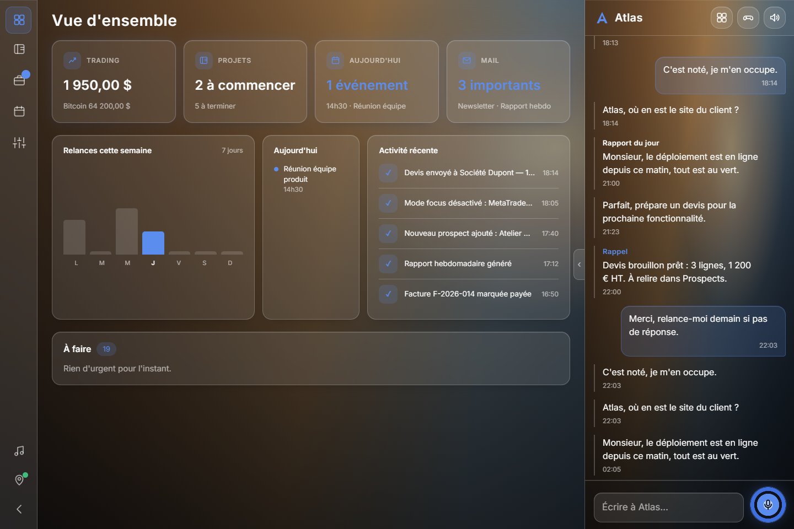
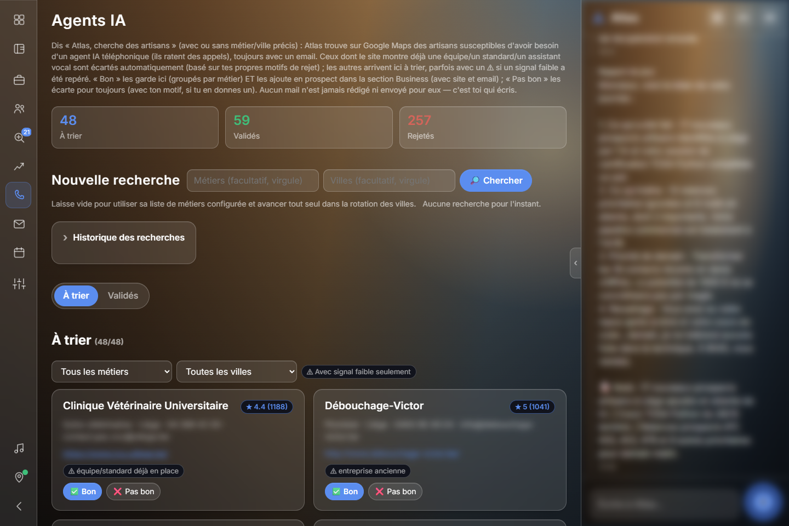

# Atlas — a personal, always-on AI assistant with real business automation and a Claude MCP server

Atlas is an always-on personal assistant I built and run daily: a Telegram bot, a voice assistant (wake-word + speech-to-text + TTS), and a web dashboard, all backed by one Node.js process (`jarvis.js`) that runs its own automations end-to-end — sourcing and triaging leads, drafting and sending outreach/follow-up emails, scheduling, job-search tracking — without a human or another LLM session driving it turn by turn. Next to that, a standalone **MCP server** lets **Claude Desktop** read and act on the same business data through Atlas's own API; it was the first integration this project was built around, but today it's a secondary, manually-driven channel kept mostly as a fallback for when Atlas itself needs a hands-on fix — the daily work now runs in Atlas directly.

**Atlas was originally called Jarvis; internal file names kept the old name.**




This repo is a **curated, read-only code export for review purposes** — not a toy demo and not a packaged installer. Real secrets, personal data (prospects, journal, calendar), and runtime-only files (voice biometrics, Telegram session, trading login state) are excluded; see [What's excluded](#whats-excluded--why) below. It isn't meant to be cloned and run as-is: it's wired into my own live Telegram bot, a running MetaTrader terminal, and my own Zoho/Google/GitHub accounts. What's here is the real logic that runs every day, for reading.

## Why voice-first

I started building Atlas while recovering from a fractured hand that kept me away from a keyboard for a few months. Talking to it wasn't a nice-to-have feature — it was the only way I could keep working. That constraint is why wake-word detection, speech-to-text and TTS came before the web dashboard did, and why almost everything in this project can be done by voice, not just by clicking through a UI.

## Why this repo exists

I use Claude daily, in two different ways: through Claude Code, to build and maintain this project itself, and through Claude Desktop via its MCP server, as a manual fallback when I want to intervene directly instead of letting Atlas run on its own. Most of the actual day-to-day work — triaging prospect replies, drafting follow-up emails, deciding which leads to disqualify, orchestrating a dozen APIs — now happens inside Atlas's own always-on process, autonomously. This repo is meant to show that work concretely: real **automation** that replaced manual daily busywork, several **API integrations** done right (OAuth flows, rate-limit discovery, empirical API-quirk handling), and a working **Model Context Protocol (MCP) server** for the cases where a human-in-the-loop channel is still worth having.

## Architecture

```
Telegram bot ──┐
Voice (wake    ├──► jarvis.js (Node.js HTTP server + action orchestrator)
 word + STT) ──┤         │
Web dashboard ─┘         ├── securite.js        → permission tiers, rate limiting, audit log, path allowlist
                          ├── externe.js         → GitHub / Netlify (read-only)
                          ├── emploi.js          → job-search monitoring + application follow-up scheduling
                          ├── fac.js             → third-party portal sync via headless-browser automation (no public API)
                          ├── habitudes.js       → learns quiet hours / response patterns
                          ├── projets.js         → dev-projects dashboard backend
                          └── trading/*.py       → MetaTrader5 bridge (demo-account only, enforced in code)

Claude Desktop ──► mcp/server.js (separate process, stdio MCP)
                          ├── atlas.js    → thin HTTP client to jarvis.js's own API (never touches the data files directly)
                          ├── zoho.js     → Zoho Mail OAuth + REST client (drafts, search, folders)
                          ├── relances.js → prospect listing / follow-up / reply-triage logic
                          └── emploi.js   → job-application follow-up tooling (mark sent, mark replied, list overdue)
```

The MCP server is **intentionally a separate process** talking to Atlas only through its HTTP API. Atlas's own long-running process is the single writer of its data files; letting a second process (Claude Desktop, via MCP) write to those files directly would risk corrupting writes. Every MCP write goes through a jarvis.js route instead.

## The MCP server (`mcp/`)

This is the part the repo's name and early history center on, and still the clearest standalone example of integration work to review — but worth being upfront that it's not where the daily automation actually runs anymore: Atlas's own process (see [Automations](#automations) below) now drafts and sends outreach, triages replies and tracks follow-ups on its own schedule. The MCP server stays wired in as a manual channel: a way to look something up or act on it directly from Claude Desktop, without going through Atlas's chat, mostly used when something needs a hands-on check.

15 tools exposed to Claude Desktop, tightly scoped on purpose — no shell access, no general mail reading, no access outside the prospect/business and job-search-follow-up workflows:

| Tool | Purpose |
|---|---|
| `lister_prospects` / `voir_prospect` / `marquer_prospect` | Browse and triage AI-sourced leads (keep / reject) |
| `lire_site` | Read a prospect's own website (homepage + contact page), text-only — never an arbitrary URL |
| `creer_brouillon` | Draft a Zoho email (signature auto-appended, dedupe-checked) |
| `lister_relances` / `marquer_relance` / `creer_relance` | Weekly follow-up cycle: due list, mark as followed-up (auto-cutoff after 2 unanswered), draft a reply in the same thread |
| `lister_a_contacter_autrement` | Leads without an email (can't be followed up by mail) |
| `lister_business` / `marquer_contacte` | General CRM lookup, and bulk-register contacts made outside the normal flow |
| `lister_candidatures_a_relancer` / `marquer_candidature_envoyee` / `marquer_candidature_reponse` / `marquer_candidature_relancee` | Same follow-up pattern as prospects, applied to job applications: mark the *actual* send date (often days after the draft was written), auto-schedule a reminder N business days later, cut off after 2 unanswered follow-ups |

Every write returns the result of the real HTTP call — no tool ever claims success without it.

### Real problems found and fixed while building this

These came up during actual development, not a spec sheet, and are a better signal of integration-engineering ability than a clean happy-path:

- **No `/drafts` endpoint.** Zoho Mail's REST API returns `404 URL_RULE_NOT_CONFIGURED` for `/api/accounts/{id}/drafts`. The correct call is `POST /messages` with `mode: "draft"` — found by testing against a real account, not in the docs.
- **The `from:` search operator is broken.** `searchKey=from:<email>` returns unrelated recent messages even for a made-up address that never sent anything — confirmed by testing a nonsense address and getting non-empty, wrong results. `to:` and `sender:` are reliable (empty on a true negative, correct on a true positive). The code never uses `from:` for a decision, and re-verifies the sender address client-side as a second safety net.
- **No way to set reply headers.** The API has no documented field for `In-Reply-To` / `References`; roughly ten field-name/endpoint variants were tried and rejected (`EXTRA_KEY_FOUND_IN_JSON` or 404). `creer_relance` reuses the same subject (`Re: ...`) and recipient instead, and **says so explicitly** in its own tool output rather than silently pretending it's a real threaded reply.
- **No public API for a third-party portal.** A recurring, schedule-bearing portal (SPA, nothing in the raw HTML) had no export/feed option. Rather than scrape pixels off a rendered page, `fac.js` drives a headless Edge instance (`playwright-core`, no bundled browser download — launches the system-installed Edge via its `channel` option), logs in, and reads the calendar's own DOM structure directly (`data-date` attributes, one `.cal-event` node per entry) across N weeks by stepping the view's own date-range URL parameter. Synced entries carry the source system's own event id so a re-sync updates or removes changed entries instead of duplicating them.
- **A restreamer bug that only showed up after repeated use.** A webcam exposed over the LAN via `go2rtc` would, after a "turn off / turn on" cycle, report the device as "already in use" — even though nothing else held it. Root-caused by reproducing it directly on the host: a `DELETE` immediately followed by a `PUT` of the same stream *within the same go2rtc process* leaves the DirectShow device internally locked; only a full process restart clears it. Fixed by having the "turn on" action restart the whole restreamer process (a tiny local relay service, reachable only over the private VPN) rather than retrying the same in-process call — then discovered a second, compounding issue (the restarted process doesn't persist the stream config, so it has to be recreated after every restart) and a third (the restart relay's own HTTP listener needs an explicit `Content-Length` header even on an empty-body `POST`, which Node's `fetch()` only sets when a body is actually passed).
- **A deprecated API version that failed with the wrong error message.** A voice-agent platform's "list calls" endpoint returned a generic `400` with no indication it had simply been replaced by a `v3` endpoint with a different request shape (`filter_criteria` instead of flat params, cursor-based pagination). Found by reading the deprecation notice linked from the error body, not the (now-outdated) quickstart docs.
- **A recurring reminder confirmation loop that never closed.** Atlas supports recurring reminders ("every day at 9pm, ask me to confirm X") that call back and retry until the person replies "done" — in production, a reply like "yeah already handled" sent during an unrelated chat message didn't match the confirmation parser, so the retry loop kept calling back on schedule even though the task was done. Root-caused by testing the exact wording against the matcher in isolation: the "already"/"yeah" phrasing fell outside the recognized confirmation patterns. Fixed three ways at once rather than just patching the regex: (1) a model-independent guard in the main chat handler now re-checks any free-text message against the confirmation matcher whenever a confirmation is outstanding, regardless of whether the model itself flagged it; (2) a dedicated "postpone" command lets a pending confirmation be rescheduled to a specific time instead of silently falling through; (3) a duplicate-reminder guard rejects a second identical reminder (same text, same minute) raised twice from a single garbled voice message.

### Privacy by design

`lister_relances`'s `a_repondu` field is a plain boolean computed server-side from an inbox search — the tool **never returns the content, sender name, or subject of a received email**, only yes/no. Reply sentiment classification (`trierReponsesProspects` in jarvis.js) runs through a **local Ollama model**, never Gemini or Claude — the content of someone's reply never leaves the machine.

## Automations

- **Outreach drafting and sending, end-to-end, no MCP involved** — Atlas reads a lead's own site, has a model write a short personalized hook plus a couple of fixed fields (never an invented fact), assembles the full email from a fixed template, and creates the actual Zoho draft via the same OAuth2 client the MCP server also uses — but driven by Atlas's own scheduler and chat commands, not by a Claude Desktop tool call. Drafts are reviewed and sent by a human; nothing is auto-sent.
- **Weekly follow-up batching** — follow-ups used to land on whatever day was "+3 days from last contact", producing a daily trickle of reminders. Now every follow-up is rounded forward to a single fixed weekday, at least 5 days out, so there's one batch session a week instead of noise every day. Auto-stops (`sans réponse` status) after 2 unanswered follow-ups instead of nagging forever.
- **Nightly lead sourcing** — searches configured trades/cities, scores each site for negative signals (already has a callbot, franchise/network site, etc.) via a handful of regexes run against the decoded page text, and auto-discards anything above a threshold before it ever reaches a human review queue.
- **Daily business health check** — overdue invoices and due follow-ups surfaced once a day, not polled constantly.
- **Job search monitoring** (`emploi.js`) — background polling with dedupe.
- **Job application follow-up** — the same weekly-batching follow-up pattern applied to job applications: a reminder is scheduled from the *real* send date (not the draft date — applications are often written days before they're actually sent), counted in business days, with the same auto-cutoff after 2 unanswered follow-ups.
- **Scheduled external sync** — `fac.js` runs on a weekly timer with a manual override, same guard pattern (`state.json`-backed "last run" timestamp) used elsewhere in the codebase for anything that shouldn't re-run on every server tick.
- **Automatic trade inference from the prospect's own site** — the same model call that drafts the first outreach email's hook is also asked to name the prospect's actual trade (electrician, plumber, locksmith...) from the site text it already reads; if the lead had no trade on file, the inferred one is backfilled rather than falling back to a generic default.
- **Follow-up prioritization from demo engagement, read-only on both sides** — a companion marketing site offers a personalized "try the phone demo" link per lead, and measures engagement with it as disclosed in the site's privacy policy. Atlas polls the Retell AI call log (whoever actually called) and, separately, an Upstash Redis list the site appends to on every page view/click (whoever opened the link but never called) — each lead matched by the slug in its own link, never a new one generated. Neither integration ever writes back: the call log is read with one filtered endpoint, the Redis list with a single `LRANGE` on one specific key. Engagement bumps a lead's follow-up priority and unlocks a more direct, pre-approved follow-up draft — drafts stay generic, and are always reviewed and sent manually, never auto-sent.
- **Background-tick resilience** — the 30-second scheduler tick used to be one long `async` function with no per-step isolation: an uncaught exception partway through silently killed every check scheduled *after* that point, for every future tick, with no error surfaced anywhere. Caught by comparing a "last ran" timestamp that had been frozen for days against the wall clock. Fixed by isolating each independent step in its own try/catch.

## Security model (`securite.js`)

Every action the LLM proposes is decided **by code, never by the prompt**:

- Three tiers per action type — `libre` (runs immediately), `confirmer` (needs explicit approval, never by voice), `interdit` (anything not in the table).
- Sliding-window rate limit on actions per minute, independent of the LLM's own judgment.
- A path allowlist for any filesystem access, with hardcoded-forbidden patterns (`.ssh`, credential files, system folders) that no config entry can override.
- Full append-only audit log of every action, its decision, and why.
- An emergency kill switch that suspends all actions instantly.

## "Uncensored" mode — elevated permissions, isolated and personal

Atlas has a second, separate mode (toggled explicitly, never on by default) that swaps the main Gemini/Claude pipeline for a local, uncensored Ollama model with fewer default conversational guardrails. It's scoped tightly: it has **no access** to the normal Atlas data (prospects, mail, journal, trading, calendar) — a completely separate code path, not a prompt instruction telling it to ignore anything. It exists for one purpose: personal, defensive OSINT on my own online exposure and my own company, and analyzing/testing security tools found on GitHub, always inside an isolated Windows Sandbox rather than the host machine. The one rule that's never relaxed, even in this mode: warn if an action would concretely harm the person themselves (their own data, their own accounts, a direct legal consequence) — see `ollama/dolphin-raw.Modelfile` for the exact system prompt.

The mechanical piece of this included in this export is **Tor as an outbound SOCKS5 proxy** (`jarvis.js`: `torDemarrer`/`torArreter`/`torFetch`/`torPageLire`, plus `tor/torrc`): a manually-toggled Tor Expert Bundle process. Anonymization serves two concrete needs here, not anonymity for its own sake: checking my own public exposure (what a search of my name or Masnasoft turns up) without that check itself showing up, tied to my own IP, in some third party's access logs; and reaching `.onion` pages, which a regular HTTP client or search API simply can't resolve. It's never started automatically — only a PC-local API call can start or stop it. The broader private system this plugs into (a separate chat UI, per-topic tabs, GitHub-tool analysis with a Windows-Defender scan step, and the sandbox launcher itself) is not part of this public export; `dolphin-raw.Modelfile` documents the full tag-based design for reference, but only the Tor plumbing is wired into this repo's `jarvis.js`.

## Tech stack

**Node.js** (core engine, CommonJS; MCP server as ESM) · **Python** (MetaTrader5 bridge, PDF parsing for CV scrubbing) · **Google Gemini** (primary LLM) with **Groq** and local **Ollama** as fallbacks · **Claude** via **MCP** (Claude Desktop) · **Zoho Mail API** (OAuth2) · **Retell AI** (voice-agent call log, read-only) · **Upstash Redis** (REST API, read-only) · **Playwright** (headless-browser automation for portals without an API) · **Telegram Bot API** · **GitHub** / **Netlify** APIs (read-only dashboard integrations) · openWakeWord / Picovoice (wake word) · Edge TTS (voice output).

`config.example.json` and `mcp/zoho_config.example.json` are included to show the full shape of the configuration (every setting is commented in French, matching the rest of the codebase) — not as a setup guide. This repo is for reading, not for running: see the note at the top.

**Secrets never live in `config.json`.** Every API key/token field in `config.example.json` is intentionally empty; real values come from environment variables at runtime (`.env`, see `.env.example` — no extra dependency, parsed by a dozen lines in `jarvis.js`). A missing variable disables its feature with a clear startup message instead of failing silently later.

## What's excluded — why

| Excluded | Reason |
|---|---|
| `config.json`, `mcp/zoho_config.json`, `mcp/zoho_token_cache.json`, `spotify.json`, `.env` | Real API keys/tokens — `*.example.json` and `.env.example` templates are provided instead |
| `business.json`, `state.json`, `agenda.json`, `projets.json`, `journal/` | Real prospect data and personal data generated at runtime |
| `appel/` | Depends on a Telegram user-session file (as sensitive as a password) |
| `voix/` | Voice-biometric profile and trained wake-word binaries, not code |
| `mail/proton_lecture.js` | Superseded by the Zoho API integration, kept out as dead code |

## License

Personal project, shared for portfolio purposes. Feel free to read and learn from it; it's not currently licensed for reuse.
