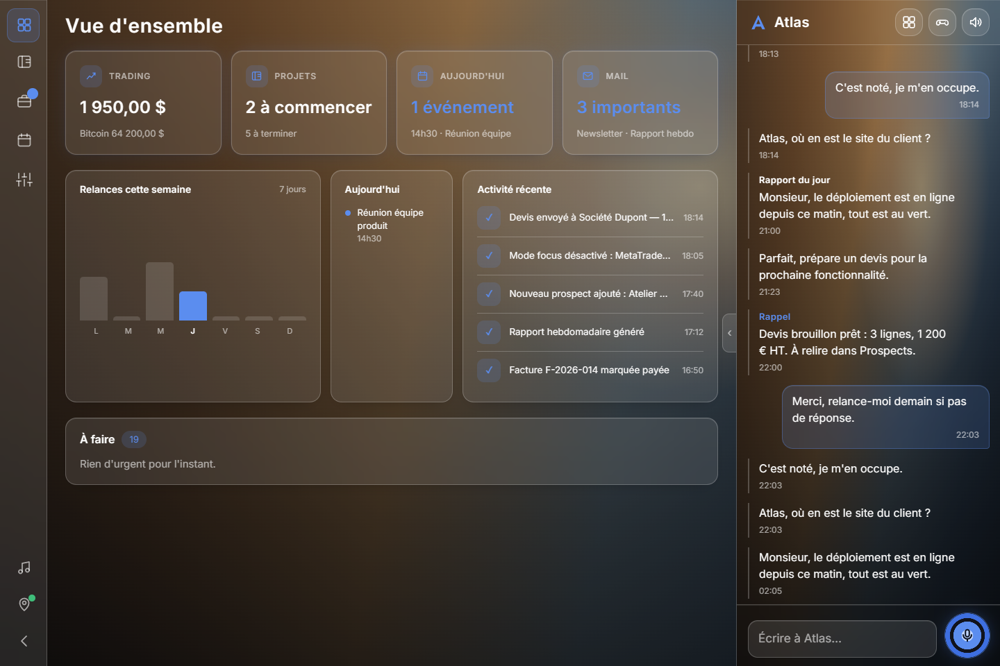
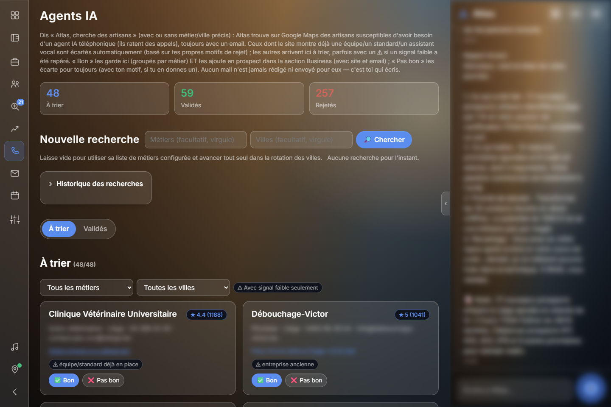

# Atlas — a personal AI assistant with a Claude MCP server, API integrations, and real business automation

Atlas is an always-on personal assistant I built and run daily: a Telegram bot, a voice assistant (wake-word + speech-to-text + TTS), and a web dashboard, all backed by one Node.js process, plus a standalone **MCP server** that lets **Claude Desktop** manage real business data (CRM-style prospect tracking, Zoho Mail drafting) through Atlas's own API.

**Atlas was originally called Jarvis; internal file names kept the old name.**




This repo is a **curated, read-only code export for review purposes** — not a toy demo and not a packaged installer. Real secrets, personal data (prospects, journal, calendar), and runtime-only files (voice biometrics, Telegram session, trading login state) are excluded; see [What's excluded](#whats-excluded--why) below. It isn't meant to be cloned and run as-is: it's wired into my own live Telegram bot, a running MetaTrader terminal, and my own Zoho/Google/GitHub accounts. What's here is the real logic that runs every day, for reading.

## Why voice-first

I started building Atlas while recovering from a fractured hand that kept me away from a keyboard for a few months. Talking to it wasn't a nice-to-have feature — it was the only way I could keep working. That constraint is why wake-word detection, speech-to-text and TTS came before the web dashboard did, and why almost everything in this project can be done by voice, not just by clicking through a UI.

## Why this repo exists

I use Claude (via this project, and via Claude Code to build it) daily for real work: triaging prospect replies, drafting follow-up emails, deciding which leads to disqualify, and orchestrating a dozen APIs. This repo is meant to show that work concretely: a working **Model Context Protocol (MCP) server**, several **API integrations** done right (OAuth flows, rate-limit discovery, empirical API-quirk handling), and **automation** that replaced manual daily busywork.

## Architecture

```
Telegram bot ──┐
Voice (wake    ├──► jarvis.js (Node.js HTTP server + action orchestrator)
 word + STT) ──┤         │
Web dashboard ─┘         ├── securite.js        → permission tiers, rate limiting, audit log, path allowlist
                          ├── externe.js         → GitHub / Netlify (read-only)
                          ├── emploi.js          → job-search monitoring + application follow-up scheduling
                          ├── fac.js             → third-party portal sync via headless-browser automation (no public API)
                          ├── habitudes.js       → learns quiet hours / response patterns
                          ├── projets.js         → dev-projects dashboard backend
                          └── trading/*.py       → MetaTrader5 bridge (demo-account only, enforced in code)

Claude Desktop ──► mcp/server.js (separate process, stdio MCP)
                          ├── atlas.js    → thin HTTP client to jarvis.js's own API (never touches the data files directly)
                          ├── zoho.js     → Zoho Mail OAuth + REST client (drafts, search, folders)
                          ├── relances.js → prospect listing / follow-up / reply-triage logic
                          └── emploi.js   → job-application follow-up tooling (mark sent, mark replied, list overdue)
```

The MCP server is **intentionally a separate process** talking to Atlas only through its HTTP API. Atlas's own long-running process is the single writer of its data files; letting a second process (Claude Desktop, via MCP) write to those files directly would risk corrupting writes. Every MCP write goes through a jarvis.js route instead.

## The MCP server (`mcp/`)

15 tools exposed to Claude Desktop, tightly scoped on purpose — no shell access, no general mail reading, no access outside the prospect/business and job-search-follow-up workflows:

| Tool | Purpose |
|---|---|
| `lister_prospects` / `voir_prospect` / `marquer_prospect` | Browse and triage AI-sourced leads (keep / reject) |
| `lire_site` | Read a prospect's own website (homepage + contact page), text-only — never an arbitrary URL |
| `creer_brouillon` | Draft a Zoho email (signature auto-appended, dedupe-checked) |
| `lister_relances` / `marquer_relance` / `creer_relance` | Weekly follow-up cycle: due list, mark as followed-up (auto-cutoff after 2 unanswered), draft a reply in the same thread |
| `lister_a_contacter_autrement` | Leads without an email (can't be followed up by mail) |
| `lister_business` / `marquer_contacte` | General CRM lookup, and bulk-register contacts made outside the normal flow |
| `lister_candidatures_a_relancer` / `marquer_candidature_envoyee` / `marquer_candidature_reponse` / `marquer_candidature_relancee` | Same follow-up pattern as prospects, applied to job applications: mark the *actual* send date (often days after the draft was written), auto-schedule a reminder N business days later, cut off after 2 unanswered follow-ups |

Every write returns the result of the real HTTP call — no tool ever claims success without it.

### Real problems found and fixed while building this

These came up during actual development, not a spec sheet, and are a better signal of integration-engineering ability than a clean happy-path:

- **No `/drafts` endpoint.** Zoho Mail's REST API returns `404 URL_RULE_NOT_CONFIGURED` for `/api/accounts/{id}/drafts`. The correct call is `POST /messages` with `mode: "draft"` — found by testing against a real account, not in the docs.
- **The `from:` search operator is broken.** `searchKey=from:<email>` returns unrelated recent messages even for a made-up address that never sent anything — confirmed by testing a nonsense address and getting non-empty, wrong results. `to:` and `sender:` are reliable (empty on a true negative, correct on a true positive). The code never uses `from:` for a decision, and re-verifies the sender address client-side as a second safety net.
- **No way to set reply headers.** The API has no documented field for `In-Reply-To` / `References`; roughly ten field-name/endpoint variants were tried and rejected (`EXTRA_KEY_FOUND_IN_JSON` or 404). `creer_relance` reuses the same subject (`Re: ...`) and recipient instead, and **says so explicitly** in its own tool output rather than silently pretending it's a real threaded reply.
- **No public API for a third-party portal.** A recurring, schedule-bearing portal (SPA, nothing in the raw HTML) had no export/feed option. Rather than scrape pixels off a rendered page, `fac.js` drives a headless Edge instance (`playwright-core`, no bundled browser download — launches the system-installed Edge via its `channel` option), logs in, and reads the calendar's own DOM structure directly (`data-date` attributes, one `.cal-event` node per entry) across N weeks by stepping the view's own date-range URL parameter. Synced entries carry the source system's own event id so a re-sync updates or removes changed entries instead of duplicating them.

### Privacy by design

`lister_relances`'s `a_repondu` field is a plain boolean computed server-side from an inbox search — the tool **never returns the content, sender name, or subject of a received email**, only yes/no. Reply sentiment classification (`trierReponsesProspects` in jarvis.js) runs through a **local Ollama model**, never Gemini or Claude — the content of someone's reply never leaves the machine.

## Automations

- **Weekly follow-up batching** — follow-ups used to land on whatever day was "+3 days from last contact", producing a daily trickle of reminders. Now every follow-up is rounded forward to a single fixed weekday, at least 5 days out, so there's one batch session a week instead of noise every day. Auto-stops (`sans réponse` status) after 2 unanswered follow-ups instead of nagging forever.
- **Nightly lead sourcing** — searches configured trades/cities, scores each site for negative signals (already has a callbot, franchise/network site, etc.) via a handful of regexes run against the decoded page text, and auto-discards anything above a threshold before it ever reaches a human review queue.
- **Daily business health check** — overdue invoices and due follow-ups surfaced once a day, not polled constantly.
- **Job search monitoring** (`emploi.js`) — background polling with dedupe.
- **Job application follow-up** — the same weekly-batching follow-up pattern applied to job applications: a reminder is scheduled from the *real* send date (not the draft date — applications are often written days before they're actually sent), counted in business days, with the same auto-cutoff after 2 unanswered follow-ups.
- **Scheduled external sync** — `fac.js` runs on a weekly timer with a manual override, same guard pattern (`state.json`-backed "last run" timestamp) used elsewhere in the codebase for anything that shouldn't re-run on every server tick.

## Security model (`securite.js`)

Every action the LLM proposes is decided **by code, never by the prompt**:

- Three tiers per action type — `libre` (runs immediately), `confirmer` (needs explicit approval, never by voice), `interdit` (anything not in the table).
- Sliding-window rate limit on actions per minute, independent of the LLM's own judgment.
- A path allowlist for any filesystem access, with hardcoded-forbidden patterns (`.ssh`, credential files, system folders) that no config entry can override.
- Full append-only audit log of every action, its decision, and why.
- An emergency kill switch that suspends all actions instantly.

## Tech stack

**Node.js** (core engine, CommonJS; MCP server as ESM) · **Python** (MetaTrader5 bridge, PDF parsing for CV scrubbing) · **Google Gemini** (primary LLM) with **Groq** and local **Ollama** as fallbacks · **Claude** via **MCP** (Claude Desktop) · **Zoho Mail API** (OAuth2) · **Playwright** (headless-browser automation for portals without an API) · **Telegram Bot API** · **GitHub** / **Netlify** APIs (read-only dashboard integrations) · openWakeWord / Picovoice (wake word) · Edge TTS (voice output).

`config.example.json` and `mcp/zoho_config.example.json` are included to show the full shape of the configuration (every setting is commented in French, matching the rest of the codebase) — not as a setup guide. This repo is for reading, not for running: see the note at the top.

**Secrets never live in `config.json`.** Every API key/token field in `config.example.json` is intentionally empty; real values come from environment variables at runtime (`.env`, see `.env.example` — no extra dependency, parsed by a dozen lines in `jarvis.js`). A missing variable disables its feature with a clear startup message instead of failing silently later.

## What's excluded — why

| Excluded | Reason |
|---|---|
| `config.json`, `mcp/zoho_config.json`, `mcp/zoho_token_cache.json`, `spotify.json`, `.env` | Real API keys/tokens — `*.example.json` and `.env.example` templates are provided instead |
| `business.json`, `state.json`, `agenda.json`, `projets.json`, `journal/` | Real prospect data and personal data generated at runtime |
| `appel/` | Depends on a Telegram user-session file (as sensitive as a password) |
| `voix/` | Voice-biometric profile and trained wake-word binaries, not code |
| `mail/proton_lecture.js` | Superseded by the Zoho API integration, kept out as dead code |

## License

Personal project, shared for portfolio purposes. Feel free to read and learn from it; it's not currently licensed for reuse.
